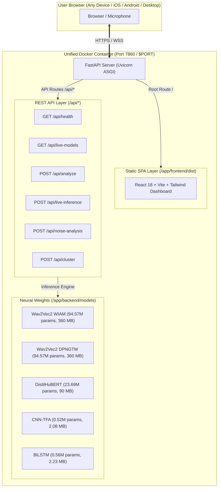

# Cloud Deployment Guide — Resonance SER Platform

Deploy the full **Resonance Speech Emotion Recognition (SER)** platform — including all 5 deep learning models and the React analytics dashboard — to a **100% free cloud hosting provider** with zero cost, no expiration, and full microphone audio access.

---

## 1. Cloud Provider Comparison for Speech Emotion Recognition

Hosting deep learning audio models requires adequate RAM to hold neural weights in memory alongside DSP libraries (Librosa, NumPy, SciPy).

| Cloud Provider | Free Tier Hardware | Cost | AI Model Compatibility | Microphone HTTPS | Idle Sleep | Recommendation |
| :--- | :--- | :--- | :--- | :--- | :--- | :--- |
| **Hugging Face Spaces** | **2 vCPU · 16 GB RAM · 50 GB Disk** | **$0 / month** (Permanent) | **Full Support** (All 5 models: Wav2Vec2, HuBERT, CNN, BiLSTM) | **Built-in HTTPS** (iOS Safari & Chrome ready) | **No Sleep** (Always active) | **#1 Recommended** |
| **Render** | 0.1 vCPU · 512 MB RAM | $0 / month (Free tier) | **Restricted** (512MB RAM causes OOM on 378MB Wav2Vec2; only compact CNN & BiLSTM run) | Built-in HTTPS | Sleeps after 15 min (50s cold start) | Secondary |
| **Railway** | 512 MB RAM | $5 trial credit only | Limited | HTTPS supported | Expires after trial | Not free |
| **Fly.io** | 256 MB RAM | Free tier | Incompatible (OOM Crash) | HTTPS supported | Sleeps | Not suitable |
| **GCP Cloud Run** | Up to 4 GB RAM | Free tier (2M req/mo) | Supported | Custom domain HTTPS | Cold starts | Requires Credit Card |

> [!IMPORTANT]
> **Why Hugging Face Spaces is the Best Choice for this Project:**
> The repository includes large transformer models (`wav2vec2_dpngtm` at 378 MB, `wav2vec2_wiam` at 378 MB, and `distilhubert` at 90 MB) alongside native PyTorch models (`cnn_tfa_model.pt` and `bilstm_model.pt`).  
> **Hugging Face Spaces provides 16 GB of RAM for free**, allowing all models to be loaded in memory concurrently without running out of memory (OOM).

---

## 2. Option A: Automated 1-Command Deployment (Fastest)

An automated deployment script is included in `scripts/`:

### Windows (PowerShell):
```powershell
.\scripts\deploy_hf.ps1 -Username "<YOUR_HF_USERNAME>" -SpaceName "resonance-ser"
```

### Linux / macOS / WSL (Bash):
```bash
./scripts/deploy_hf.sh "<YOUR_HF_USERNAME>" "resonance-ser"
```

The script will:
1. Verify Git and Git LFS.
2. Track model weights (`*.safetensors`, `*.bin`, `*.pt`) using Git LFS.
3. Build the production React frontend.
4. Add the Hugging Face Space git remote.
5. Push the repository and AI models to Hugging Face.

---

## 3. Option B: Step-by-Step Manual Deployment (Hugging Face Spaces)

### Step 1: Create a Free Hugging Face Account
1. If you don't already have one, create an account at [huggingface.co/join](https://huggingface.co/join).
2. Generate an Access Token with **Write** permissions at [huggingface.co/settings/tokens](https://huggingface.co/settings/tokens).

### Step 2: Create a New Space
1. Navigate to [huggingface.co/new-space](https://huggingface.co/new-space).
2. Fill in the Space settings:
   - **Space Name:** `resonance-ser` (or any name you prefer)
   - **License:** `mit` or `apache-2.0`
   - **Space SDK:** Select **Docker** -> **Blank**
   - **Space Hardware:** Select **Free (CPU basic · 2 vCPU · 16 GB RAM)**
3. Click **Create Space**.

### Step 3: Push Your Project via Git
Open a terminal in the project root (`n:\Projects\nndlnew`) and run:

```bash
# 1. Initialize git and Git LFS
git init
git branch -M main
git lfs install
git lfs track "*.pt" "*.bin" "*.safetensors" "*.onnx"

# 2. Add the Hugging Face remote (replace with your username and space name)
git remote add space https://huggingface.co/spaces/<YOUR_USERNAME>/resonance-ser

# 3. Stage files and commit
git add .
git commit -m "Deploy Resonance SER platform with full neural model suite"

# 4. Push to Hugging Face Spaces
git push -u space main --force
```

> [!NOTE]
> When Git prompts for credentials:
> - **Username:** Your Hugging Face username
> - **Password:** Your Hugging Face **Access Token** (from Step 1)

### Step 4: Access Your Live Application
Hugging Face will automatically build the container and deploy the app in **2–4 minutes**.
- **Space Dashboard & Build Logs:** `https://huggingface.co/spaces/<YOUR_USERNAME>/resonance-ser`
- **Direct Web App URL:** `https://<YOUR_USERNAME>-resonance-ser.hf.space`

---

## 4. Option C: Alternative Deployment to Render.com

If you want a secondary deployment on Render:

1. Push your code to a GitHub repository.
2. Log in to [dashboard.render.com](https://dashboard.render.com).
3. Click **New +** -> **Web Service**.
4. Connect your GitHub repository.
5. Render will automatically detect `render.yaml` or you can configure:
   - **Runtime:** `Docker`
   - **Plan:** `Free`
   - **Port:** Render automatically injects `$PORT` (the `Dockerfile` handles this dynamically).
6. Click **Deploy Web Service**.

> [!WARNING]
> Render's free tier has a **512 MB RAM limit**.  
> If you test the 378 MB Wav2Vec2 models on Render Free, the container may trigger an Out-Of-Memory (OOM) restart. On Render Free, use the compact **CNN-TFA (2.08 MB)** or **BiLSTM (2.23 MB)** models or simulation mode. For full Wav2Vec2/HuBERT models, use **Hugging Face Spaces**.

---

## 5. Local Container Testing with Docker Compose

To test the containerized production build on your machine before pushing:

```bash
# Build and run the unified container locally
docker compose up --build
```

- Open `http://localhost:7860` in your browser.
- Health Check: `http://localhost:7860/api/health`
- Active Models: `http://localhost:7860/api/live-models`

---

## 6. Architecture of the Deployed Production Container

The application is deployed as a single, self-contained multi-stage Docker container:



### Key Engineering Features of this Container:
1. **Multi-Stage Node & Python Build**: Frontend TypeScript is compiled during Stage 1 and served directly by FastAPI as static files, eliminating the need for a separate Node.js runtime in production.
2. **CPU-Only PyTorch Optimization**: Uses `--index-url https://download.pytorch.org/whl/cpu` to avoid downloading 2.5 GB of Nvidia CUDA binaries, shrinking the image footprint by ~80% and drastically speeding up cloud build times.
3. **Audio DSP Integration**: Pre-installs `libsndfile1` and `ffmpeg` inside the container so multi-format audio files (.wav, .mp3, .ogg, .flac) decode with 100% reliability.
4. **Hugging Face Rootless Compliance**: Configured with a dedicated non-root user `user` (UID 1000), meeting all security requirements for Hugging Face Spaces and major cloud providers.
5. **Git LFS Architecture**: Model weights (`*.safetensors`, `*.bin`, `*.pt`) are tracked via Git LFS, preventing repository bloat and Git rejection.

---

## 7. Verification Checklist After Deployment

Once your app finishes building on Hugging Face Spaces or Render:

- [ ] **Health Endpoint**: Navigate to `https://<YOUR-URL>/api/health`. Should return `"status": "ok"` with library versions.
- [ ] **Model Registry**: Navigate to `https://<YOUR-URL>/api/live-models`. Should display all 5 deep learning models as active.
- [ ] **Frontend Loading**: Navigate to `https://<YOUR-URL>/`. The academic research UI should load instantly.
- [ ] **Microphone Capture**: Open the **Audio Analysis** or **Live Inference** tab, record a sample, and verify emotion prediction and probability distributions.
