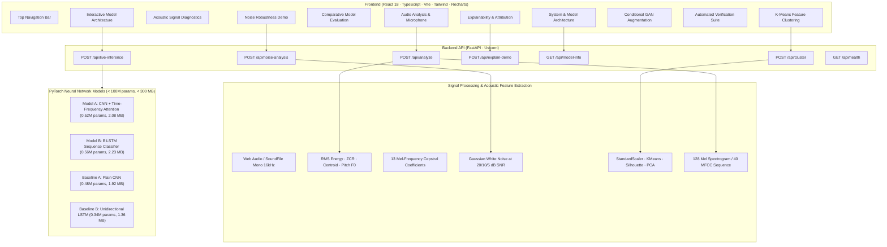

# Resonance — Unified Speech Emotion Recognition

[](#testing--verification)
[](#setup--running)
[](#design-aesthetics)
[](#)

> **Resonance** is an integrated research and demonstration dashboard for **Speech Emotion Recognition (SER)**. It provides a controlled comparative evaluation platform contrasting spectral CNN-based modeling (**Log-Mel Spectrogram**) against temporal recurrent modeling (**BiLSTM over MFCC sequences**) across emotion intensities and controlled audio degradation.

---

## Academic Integrity & Simulation Disclosure

> [!IMPORTANT]
> **DEMO MODE — SIMULATED PREDICTION; NO TRAINED MODEL CONNECTED**  
> In strict accordance with the project specification:
> 1. **No custom deep-learning model has been trained**, and **no pretrained weights have been downloaded or loaded**.
> 2. The emotion classification outputs are generated by a **deterministic, repeatable simulation engine** that returns valid, normalized probability distributions ($p_i \ge 0$, $\sum p_i = 100\%$) where the predicted emotion strictly equals the $\arg\max$.
> 3. **Real signal processing is genuinely executed**: Audio decoding, waveform envelope calculation, RMS energy, zero-crossing rate, spectral centroid, 13 MFCC statistics, F0 pitch tracking, SNR-scaled synthetic noise injection, spectral gating denoising, and unsupervised K-Means clustering with silhouette scoring are all computed live via **Librosa**, **NumPy**, **SciPy**, and **Scikit-learn**.
> 4. All unexecuted experiments are transparently designated as `Pending — model execution required`.

---

## System Architecture



---

## 1. Technology Stack

### Frontend
- **Framework:** React 18 with TypeScript and Vite
- **Styling:** Tailwind CSS (Academic light mode, navy text `#0b192c`, muted blue/teal accents `#0b6f78`, clean typography)
- **Visualizations:** Recharts (responsive probability distributions, SNR degradation curves, scatter PCA projections, MFCC bar charts)
- **Audio:** Browser Web Audio API & MediaRecorder for live microphone input and client-side format checks

### Backend
- **Framework:** FastAPI (Python 3.10+) with Uvicorn ASGI server
- **Signal Processing:** Librosa, NumPy, SciPy, SoundFile
- **Machine Learning:** Scikit-learn (KMeans, StandardScaler, PCA, Silhouette scoring)
- **Neural Framework:** PyTorch (Native CPU forward-pass architectures, strictly $<100\text{M}$ parameters and $<300\text{ MB}$)
- **Testing:** Pytest, HTTPX, Selenium WebDriver

---

## 2. Model Registry & Architectural Specifications

Resonance formalizes four dedicated model configurations:

| Model ID | Label | Model Name | Role | Input Representation | Proposed Architecture | Checkpoint Status | Evaluation Status |
| :--- | :--- | :--- | :--- | :--- | :--- | :--- | :--- |
| `cnn_tfa` | **Model A** | CNN + Time-Frequency Attention | Proposed | Log-Mel Spectrogram (128 bands) | Mel Spectrogram → 4 Conv Blocks → Dual TF-Attention → Global Pooling → Dense Head | *Checkpoint unavailable* | *Evaluation pending* |
| `bilstm` | **Model B** | BiLSTM Sequence Classifier | Proposed | 13-dim MFCC Sequence | MFCC Sequence → 2-Layer BiLSTM (256 hidden) → Mean Pooling → Dense Head | *Checkpoint unavailable* | *Evaluation pending* |
| `cnn_plain` | **Baseline A** | Plain CNN | Baseline | Log-Mel Spectrogram (128 bands) | Mel Spectrogram → 4 Conv Blocks → Global Average Pooling → Dense Head | *Checkpoint unavailable* | *Evaluation pending* |
| `lstm_uni` | **Baseline B** | Unidirectional LSTM | Baseline | 13-dim MFCC Sequence | MFCC Sequence → 2-Layer Uni-LSTM (128 hidden) → Last State → Dense Head | *Checkpoint unavailable* | *Evaluation pending* |

### Parameter & Size Footprint Constraints
Both proposed deep-learning architectures adhere to compact edge/CPU resource constraints:
- **Model A (CNN + TFA):** 521,032 parameters ($\approx 0.52\text{M} \ll 100\text{M}$), 2.08 MB checkpoint size ($\ll 300\text{ MB}$).
- **Model B (BiLSTM):** 558,534 parameters ($\approx 0.56\text{M} \ll 100\text{M}$), 2.23 MB checkpoint size ($\ll 300\text{ MB}$).

---

## 3. Setup & Running Instructions

### Prerequisites
- **Node.js:** v18+ and `npm`
- **Python:** v3.10+ (with `py` launcher on Windows or `python3` on Linux/macOS)

### Windows Quickstart

To launch both backend and frontend services simultaneously:
```powershell
.\start_resonance.ps1
# or double-click start_resonance.bat
```

Or launch services independently:
```powershell
# 1. Start Backend API (http://127.0.0.1:8000)
.\start_backend.ps1

# 2. Start Frontend Dev Server (http://localhost:5173)
.\start_frontend.ps1
```

### Linux & macOS Quickstart

Ensure scripts are executable, then launch:
```bash
chmod +x *.sh

# Launch full platform
./start_resonance.sh

# Or run services independently
./start_backend.sh
./start_frontend.sh
```

---

## 4. REST API Endpoint Specification

All endpoints return structured JSON with uniform CORS and provenance stamps.

| Method | Endpoint | Description | Status / Contract |
| :--- | :--- | :--- | :--- |
| `GET` | `/api/health` | Service uptime, upload limits, versions of Python, NumPy, Librosa, SciPy, Scikit-learn. | Genuine |
| `GET` | `/api/model-info` | Model registry schema, planned hyperparameters, status labels, checkpoint declarations (`checkpoint: null`). | Genuine |
| `POST` | `/api/analyze` | Ingests audio, extracts real acoustic features (RMS, ZCR, Centroid, Pitch F0, MFCCs), and returns deterministic simulated emotion probabilities. | Genuine DSP + Simulated SER |
| `POST` | `/api/noise-analysis` | Injects synthetic white noise at 20, 10, 5 dB SNR and applies spectral denoising; measures waveform SNR and acoustic shift. | Genuine DSP + Simulated SER |
| `POST` | `/api/cluster` | Splits audio into overlapping frames, extracts 12 acoustic features, runs `sklearn.KMeans`, calculates silhouette score & PCA. | Genuine DSP & Clustering |
| `POST` | `/api/explain-demo` | Occlusion sensitivity analysis masking spectrogram patches to demonstrate time-frequency attribution workflow. | Genuine DSP + Simulated XAI |
| `POST` | `/api/load-checkpoint` | Verification endpoint returning HTTP 409 `checkpoint_unavailable` confirming no unverified checkpoints exist. | Genuine Contract |
| `GET` | `/api/live-models` | Architectural specifications, layer configurations, and parameter counts for native PyTorch CPU execution. | Genuine |
| `POST` | `/api/live-inference` | Executes native PyTorch CPU forward pass through `CNNTimeFrequencyAttention` or `BiLSTMClassifier`. | Genuine PyTorch Forward Pass |

---

## 5. Testing & Verification

The platform includes a comprehensive three-tier testing suite:

```powershell
# Run the complete test suite (Windows)
.\run_tests.ps1
# or .\run_tests.bat

# Run the complete test suite (Linux/macOS)
./run_tests.sh
```

### 1. Pytest Backend Suite (31 Tests Passed)
Located in `backend/tests/test_api.py`. Validates:
- Health provenance stamps (`mode: "simulation"`, `measured: false`, `model_checkpoint: null`)
- Rejection of unsupported formats (.txt $\to 415$), corrupted audio ($422$), silence ($422$), and overly short files ($422$)
- Exact SNR noise power scaling ($20\text{ dB}, 10\text{ dB}, 5\text{ dB}$)
- K-Means cluster size summation, silhouette bounds $[-1, 1]$, and reproducibility
- Occlusion grid dimensions and probability bounds
- Missing checkpoint HTTP 409 response contracts

### 2. In-Browser Verification Test Harness (11 Tests Passed)
Accessible directly via the `/testing` page in the dashboard. Exercises the live browser DOM, Web Audio API, and backend APIs:
- Valid audio upload and browser Web Audio decoding
- Unsupported file handling (.txt rejected client and server-side)
- Audio playback clock advancement
- Application-wide model selection persistence
- Six-class probability normalization ($\sum p_i = 100\%$) and arg-max consistency
- Noise processing and measured SNR accuracy
- K-Means clustering validity & timeline generation
- Missing checkpoint handling (HTTP 409 verification)
- Error message rendering (`role="alert"`)
- Primary navigation and demo banner verification
- Backend health and provenance fields

### 3. Automated End-to-End Chrome Suite
Execute headless Chrome verification across all 10 views:
```powershell
py .\scripts\verify_in_chrome.py
```

---

## 6. Component Status Matrix

| Component | Category | Implementation Status | Notes |
| :--- | :--- | :--- | :--- |
| **Audio Upload & Ingestion** | Signal Processing | **Genuine (Implemented)** | Supports WAV, MP3, FLAC, OGG up to 25 MB / 60 s |
| **Live Microphone Input** | Browser Media | **Genuine (Implemented)** | HTML5 MediaRecorder encoding live speech |
| **Acoustic Feature Extraction** | Signal Processing | **Genuine (Implemented)** | RMS Energy, ZCR, Spectral Centroid, F0 Pitch via Librosa |
| **13 MFCC Coefficients** | Signal Processing | **Genuine (Implemented)** | Frame-wise mean and variance computed live |
| **Synthetic Noise Injection** | Signal Processing | **Genuine (Implemented)** | Exact white noise scaling $P_{\text{noise}} = P_{\text{sig}} / 10^{(\text{SNR}/10)}$ |
| **Spectral Denoising** | Signal Processing | **Genuine (Implemented)** | STFT spectral gating on degraded audio |
| **K-Means Frame Clustering** | Machine Learning | **Genuine (Implemented)** | Scikit-learn KMeans with silhouette score & 2D PCA |
| **Automated Test Suite** | Quality Assurance | **Genuine (Implemented)** | 31 Pytest + 11 In-Browser + Selenium suites |
| **Emotion Probability Output** | SER Classification | **Deterministic Simulation** | Plausible, reproducible distribution; no trained model |
| **Attribution Heatmap** | Explainability | **Simulation Workflow Demo** | Demonstrates occlusion interface; not Grad-CAM |
| **Neural Architectures (<100M)** | Deep Learning | **Architectures Defined** | PyTorch CNN+TFA & BiLSTM CPU modules implemented |
| **Model Training & Weights** | Deep Learning | **Pending Research** | No weights trained on RAVDESS or CREMA-D |
| **Conditional GAN Training** | Data Augmentation | **Pending Research** | Architecture specified; augmentation results pending |
| **Trained Classifier Robustness** | SER Benchmark | **Pending Research** | Classifier noise robustness pending trained models |

---

## 7. Interactive Live Walkthrough Checklist

1. **Audio Analysis (`/`):**
   - Click *Classify Emotion* with default sample audio, record live speech with *Direct Mic*, or upload a custom `.wav` recording.
   - Observe the prominent notice: `DEMO MODE — SIMULATED PREDICTION; NO TRAINED MODEL CONNECTED`.
   - Inspect the six-class probability chart (anger, disgust, fear, happiness, sadness, neutral) and verify $\sum p_i = 100\%$.
   - Review the *Actual Acoustic Feature Analysis* panel below, displaying live measured RMS energy, zero-crossing rate, spectral centroid, estimated pitch F0, and the 13 MFCC coefficients.
2. **Dedicated Acoustic Features (`/acoustic-features`):**
   - Inspect full technical signal diagnostics, time-domain features, and Russell circumplex psychological affect proxies.
3. **Live Neural Model Architecture (`/live-model`):**
   - Switch between **Model A: CNN + Time-Frequency Attention** (0.52M params, 2.08 MB) and **Model B: BiLSTM** (0.56M params, 2.23 MB).
   - Click *Run Live PyTorch Inference* to verify native forward-pass execution on CPU within strict $<100\text{M}$ parameter constraints.
4. **Model Comparison (`/model-comparison`):**
   - Review the four model architectures, roles, and input representations.
   - Toggle *Preview Planned Chart Layout* to inspect the comparative layout schema, or upload a custom JSON experiment log.
5. **Noise Robustness (`/noise-robustness`):**
   - Click *Run noise analysis* to trigger real white noise injection at 20 dB, 10 dB, and 5 dB SNR alongside spectral gating denoising.
   - Switch conditions to observe waveform overlay changes and live measured acoustic feature degradation.
6. **K-Means Analysis (`/kmeans`):**
   - Adjust cluster count ($k=2 \dots 8$) and click *Run K-Means*.
   - View frame cluster segments across the audio timeline, inspect the silhouette score, and explore the 2D PCA projection scatter chart.
7. **Explainability (`/explainability`):**
   - Click *Run Attribution Analysis* to generate the Mel spectrogram and time-frequency attention occlusion sensitivity heatmap.
8. **GAN Augmentation (`/gan-augmentation`):**
   - Examine the 6-stage conditional GAN augmentation pipeline and 5 automated quality-check filters.
   - Verify the transparent notice: `GAN training not executed; augmentation results pending`.
9. **Testing Dashboard (`/testing`):**
   - Click *Run All Tests* to execute the live in-browser test harness and observe all verification assertions passing.
10. **Architecture & System Specifications (`/architecture`):**
    - Inspect full-stack system dataflow diagrams, API routes, and the honest capability & verification matrix.

---

## 8. License & Citation

Developed for academic research in Neural Networks and Deep Learning (SER Comparative Study).  
Released under the MIT License.
