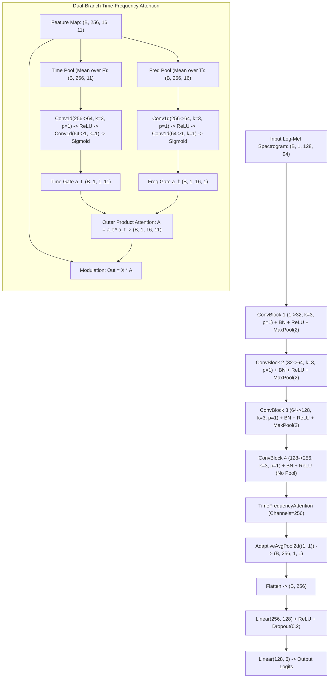
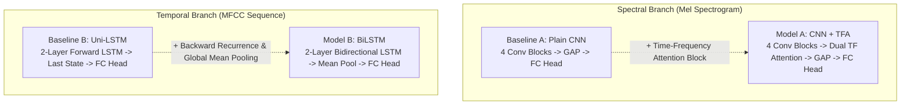

# 05. Neural Model Architectures (Deep Dive & Mathematical Foundations)

> **Core Emphasis Guide**: This document details every neural architecture in the Resonance repository (`backend/app/neural_models.py` and `backend/models/`), complete with theoretical foundations, tensor flow diagrams, layer-by-layer dimension transformations, parameter count calculations, and comparative trade-offs.

---

## 5.1 Deep Learning for Speech Emotion Recognition: Foundations

Speech Emotion Recognition (SER) is fundamentally difficult because human speech conveys two orthogonal streams of information simultaneously:
1. **Linguistic Content (What is said)**: Phonemes, words, syntax.
2. **Paralinguistic / Prosodic Cues (How it is said)**: Pitch contour ($F_0$), energy dynamics, speaking rate, voice quality (creaky, breathy, tense), and spectral tilt.

In deep learning, we approach this challenge using two primary paradigms:
* **Spectral / 2D Spatial Representations (CNNs)**: Treat the time-frequency representation (e.g., Log-Mel Spectrogram) as an image. Convolutional filters capture local harmonic structures, formant transitions, and energy bursts.
* **Temporal / Sequential Representations (RNNs / LSTMs)**: Treat frame-level feature vectors (e.g., MFCCs) as time series. Recurrent cells preserve temporal state across hundreds of milliseconds to model prosodic intonation.
* **Self-Supervised Pretrained Representations (Acoustic Transformers)**: Massive encoders (Wav2Vec 2.0, HuBERT) pretrained on thousands of hours of unlabeled audio using contrastive or masked-prediction objectives, fine-tuned with a linear classification head for emotion.

---

## 5.2 Model A: CNN + Time-Frequency Attention (CNN-TFA)

Implemented in `backend/app/neural_models.py` as `CNNTimeFrequencyAttention` and `TimeFrequencyAttention`.

### 5.2.1 High-Level Architectural Flow


---

### 5.2.2 Layer-by-Layer Dimension & Parameter Breakdown

Input audio: 3.0 s mono at 16 kHz $\implies 48,000$ samples.
Log-Mel transform: `n_fft=1024, hop_length=512, n_mels=128`.
Frames $T = 1 + \lfloor 48000 / 512 \rfloor = 94$.
Input tensor shape: $(B, C, F, T) = (B, 1, 128, 94)$.

#### Layer Operations and Tensor Shapes:
1. **Input**: $(B, 1, 128, 94)$
2. **ConvBlock 1**:
   * `Conv2d(1, 32, kernel_size=3, padding=1)`: Shape $(B, 32, 128, 94)$
     $$\text{Weights} = (3 \times 3 \times 1) \times 32 = 288, \quad \text{Biases} = 32 \implies 320$$
   * `BatchNorm2d(32)`: Shape $(B, 32, 128, 94)$
     $$\gamma, \beta = 32 + 32 = 64 \text{ parameters}$$
   * `ReLU()`
   * `MaxPool2d(2)`: Spatial halving $\implies (B, 32, 64, 47)$
3. **ConvBlock 2**:
   * `Conv2d(32, 64, kernel_size=3, padding=1)`: Shape $(B, 64, 64, 47)$
     $$\text{Weights} = (3 \times 3 \times 32) \times 64 = 18,432, \quad \text{Biases} = 64 \implies 18,496$$
   * `BatchNorm2d(64)`: $64 \times 2 = 128$ parameters
   * `ReLU()`
   * `MaxPool2d(2)`: $\implies (B, 64, 32, 23)$
4. **ConvBlock 3**:
   * `Conv2d(64, 128, kernel_size=3, padding=1)`: Shape $(B, 128, 32, 23)$
     $$\text{Weights} = (3 \times 3 \times 64) \times 128 = 73,728, \quad \text{Biases} = 128 \implies 73,856$$
   * `BatchNorm2d(128)`: $128 \times 2 = 256$ parameters
   * `ReLU()`
   * `MaxPool2d(2)`: $\implies (B, 128, 16, 11)$
5. **ConvBlock 4** (No pooling):
   * `Conv2d(128, 256, kernel_size=3, padding=1)`: Shape $(B, 256, 16, 11)$
     $$\text{Weights} = (3 \times 3 \times 128) \times 256 = 294,912, \quad \text{Biases} = 256 \implies 295,168$$
   * `BatchNorm2d(256)`: $256 \times 2 = 512$ parameters
   * `ReLU()` $\implies (B, 256, 16, 11)$

#### Dual-Branch Time-Frequency Attention (`channels = 256`):
* **Time Branch**:
  * Input pooled over frequency: `x.mean(dim=2)` $\implies (B, 256, 11)$
  * `time_conv`: `nn.Conv1d(256, 64, kernel_size=3, padding=1)`
    $$\text{Params} = (3 \times 256) \times 64 + 64 = 49,216$$
  * `ReLU()`
  * `time_out`: `nn.Conv1d(64, 1, kernel_size=1)`
    $$\text{Params} = (1 \times 64) \times 1 + 1 = 65$$
  * `Sigmoid()` $\implies a_t \in (B, 1, 11)$
* **Frequency Branch**:
  * Input pooled over time: `x.mean(dim=3)` $\implies (B, 256, 16)$
  * `freq_conv`: `nn.Conv1d(256, 64, kernel_size=3, padding=1)`
    $$\text{Params} = (3 \times 256) \times 64 + 64 = 49,216$$
  * `ReLU()`
  * `freq_out`: `nn.Conv1d(64, 1, kernel_size=1)`
    $$\text{Params} = (1 \times 64) \times 1 + 1 = 65$$
  * `Sigmoid()` $\implies a_f \in (B, 1, 16)$
* **Outer Product Modulation**:
  $$\text{attn\_map} = a_t.\text{unsqueeze}(2) \times a_f.\text{unsqueeze}(3) \implies (B, 1, 16, 11)$$
  $$\text{out} = x \odot \text{attn\_map} \implies (B, 256, 16, 11)$$

#### Classification Head:
* `AdaptiveAvgPool2d((1, 1))`: $(B, 256, 1, 1)$
* `Flatten()`: $(B, 256)$
* `Linear(256, 128)`:
  $$\text{Weights} = 256 \times 128 = 32,768, \quad \text{Biases} = 128 \implies 32,896$$
* `ReLU()`, `Dropout(0.2)`
* `Linear(128, 6)`:
  $$\text{Weights} = 128 \times 6 = 768, \quad \text{Biases} = 6 \implies 774$$

---

### 5.2.3 Exact Parameter Summation Table

$$\begin{array}{|l|l|r|}
\hline
\textbf{Component} & \textbf{Layers} & \textbf{Parameter Count} \\
\hline
\text{ConvBlock 1} & \text{Conv2d(1, 32) + BN(32)} & 320 + 64 = 384 \\
\text{ConvBlock 2} & \text{Conv2d(32, 64) + BN(64)} & 18,496 + 128 = 18,624 \\
\text{ConvBlock 3} & \text{Conv2d(64, 128) + BN(128)} & 73,856 + 256 = 74,112 \\
\text{ConvBlock 4} & \text{Conv2d(128, 256) + BN(256)} & 295,168 + 512 = 295,680 \\
\text{Time Attention Branch} & \text{Conv1d(256, 64) + Conv1d(64, 1)} & 49,216 + 65 = 49,281 \\
\text{Freq Attention Branch} & \text{Conv1d(256, 64) + Conv1d(64, 1)} & 49,216 + 65 = 49,281 \\
\text{Dense Head} & \text{Linear(256, 128) + Linear(128, 6)} & 32,896 + 774 = 33,670 \\
\hline
\textbf{Total Parameters} & \textbf{CNN-TFA Model} & \mathbf{521,032} \\
\hline
\end{array}$$

*Note: $521,032 \times 4 \text{ bytes/float32} = 2,084,128 \text{ bytes} \approx 1.99 \text{ MiB} \approx 2.08 \text{ MB}$. This matches the file size of `cnn_tfa_model.pt` (2,101,439 bytes including PyTorch header overhead).*

---

## 5.3 Model B: Bidirectional LSTM Sequence Classifier (BiLSTM)

Implemented in `backend/app/neural_models.py` as `BiLSTMClassifier`.

### 5.3.1 Mathematical Formulation of BiLSTM
For each frame $t \in [1, T]$, given input vector $x_t \in \mathbb{R}^{d}$ (where $d = 13$ MFCCs):
An LSTM cell controls information flow through three gating mechanisms (input $i_t$, forget $f_t$, output $o_t$) and an internal memory cell $c_t$:

$$f_t = \sigma(W_f x_t + U_f h_{t-1} + b_f)$$
$$i_t = \sigma(W_i x_t + U_i h_{t-1} + b_i)$$
$$\tilde{c}_t = \tanh(W_c x_t + U_c h_{t-1} + b_c)$$
$$c_t = f_t \odot c_{t-1} + i_t \odot \tilde{c}_t$$
$$o_t = \sigma(W_o x_t + U_o h_{t-1} + b_o)$$
$$h_t = o_t \odot \tanh(c_t)$$

In a **Bidirectional LSTM**, two separate hidden state sequences are computed:
* Forward state: $\overrightarrow{h}_t = \text{LSTM}_{\text{fwd}}(x_t, \overrightarrow{h}_{t-1})$
* Backward state: $\overleftarrow{h}_t = \text{LSTM}_{\text{bwd}}(x_t, \overleftarrow{h}_{t+1})$
* Concatenated hidden state: $h_t = [\overrightarrow{h}_t \,\|\, \overleftarrow{h}_t] \in \mathbb{R}^{2 \cdot h_{\text{dim}}}$

Temporal pooling compresses the sequence of hidden states across all frames $T$:
$$h_{\text{pooled}} = \frac{1}{T} \sum_{t=1}^{T} h_t$$

Finally, classification logits are produced:
$$\hat{y} = W_2 \cdot \text{ReLU}(W_1 h_{\text{pooled}} + b_1) + b_2$$

---

### 5.3.2 BiLSTM Parameter Calculation

PyTorch stores separate input-to-hidden and hidden-to-hidden bias vectors for each gate:
$$\text{Params}_{\text{LSTM layer}} = 2 \times \Big( 4 \times \big( \text{input\_dim} \times \text{hidden\_dim} + \text{hidden\_dim}^2 + 2 \times \text{hidden\_dim} \big) \Big)$$
*(The leading factor of 2 accounts for bidirectionality).*

#### Layer 1:
* `input_dim = 13`, `hidden_dim = 128`, `bidirectional = True`:
  $$\text{Forward}: 4 \times (13 \times 128 + 128^2 + 2 \times 128) = 4 \times (1,664 + 16,384 + 256) = 4 \times 18,304 = 73,216$$
  $$\text{Backward}: 73,216$$
  $$\text{Total Layer 1} = 73,216 \times 2 = \mathbf{146,432}$$

#### Layer 2:
* `input_dim = 256` (concatenation of forward and backward from Layer 1), `hidden_dim = 128`, `bidirectional = True`:
  $$\text{Forward}: 4 \times (256 \times 128 + 128^2 + 2 \times 128) = 4 \times (32,768 + 16,384 + 256) = 4 \times 49,408 = 197,632$$
  $$\text{Backward}: 197,632$$
  $$\text{Total Layer 2} = 197,632 \times 2 = \mathbf{395,264}$$

#### Fully Connected Head:
* `Linear(hidden_dim * 2, 64)` $\implies \text{Linear}(256, 64)$:
  $$\text{Weights} = 256 \times 64 = 16,384, \quad \text{Biases} = 64 \implies 16,448$$
* `Linear(64, 6)`:
  $$\text{Weights} = 64 \times 6 = 384, \quad \text{Biases} = 6 \implies 390$$

#### Total Summation:
$$\mathbf{Total} = 146,432 + 395,264 + 16,448 + 390 = \mathbf{558,534} \text{ parameters}$$
*Memory: $558,534 \times 4 = 2,234,136 \text{ bytes} \approx 2.23 \text{ MB}$. Matches `bilstm_model.pt` (2,241,065 bytes).*

---

## 5.4 Baseline Comparators & Ablation Studies

In formal machine learning research, proposing a novel architecture requires rigorous **ablation studies** to prove *which* components are responsible for empirical gains.



### 1. Model A vs. Baseline A (Plain CNN)
* **What is isolated**: The specific benefit of the dual-branch Time-Frequency Attention mechanism.
* **Why it matters**: A standard 2D CNN treats all spatial regions equally across the intermediate feature maps. However, emotional cues in speech are concentrated in specific formant bands (e.g., $F_1, F_2$ shifts in vowel elongation for sadness) and transient temporal bursts (e.g., rapid energy rise in anger).
* **Ablation hypothesis**: If CNN+TFA outperforms Plain CNN, it proves that the model successfully learns to attend to emotion-salient time-frequency patches while suppressing uninformative background frames.

### 2. Model B vs. Baseline B (Unidirectional LSTM)
* **What is isolated**: The impact of non-causal bidirectional context.
* **Why it matters**: A unidirectional LSTM processes speech strictly left-to-right ($t=1 \to T$). When classifying emotion at the end of an utterance, the model must maintain memory of early acoustic cues (e.g., pitch rise at syllable 1) across the entire recurrent chain. A bidirectional LSTM computes representations with future context ($\overleftarrow{h}_t$), capturing prosodic cadence and end-of-sentence pitch declination.
* **Ablation hypothesis**: BiLSTM will show higher recall on emotions characterized by global prosodic shifts (e.g., sadness, depression) than Uni-LSTM.

---

## 5.5 Pretrained Acoustic Transformers in Resonance

The repository stores three fine-tuned transformer model checkpoints in `backend/models/`:

### 1. `wav2vec2_wiam`
* **Base Model**: `facebook/wav2vec2-base` (12 Transformer blocks, hidden dimension 768, 8 attention heads).
* **Fine-tuned by**: Hugging Face user `Wiam` on the RAVDESS dataset.
* **Parameters**: 94,570,632 (~94.57M).
* **Disk Size**: 378.35 MB (`pytorch_model.bin`).
* **Input**: 16 kHz raw waveform. Feature extractor applies convolution subsampling (stride 20ms, receptive field 25ms).

### 2. `wav2vec2_dpngtm`
* **Base Model**: `facebook/wav2vec2-base`.
* **Fine-tuned by**: Hugging Face user `Dpngtm` for sequence classification.
* **Parameters**: 94,570,375 (~94.57M).
* **Disk Size**: ~361 MB (`model.safetensors`).

### 3. `distilhubert`
* **Base Model**: `ntu-spml/distilhubert` (knowledge-distilled HuBERT model, 2 Transformer layers, hidden dimension 768).
* **Parameters**: 23,690,888 (~23.69M).
* **Disk Size**: 90.38 MB (`model.safetensors`).
* **Constraint Compliance**: Strictly complies with both $< 100\text{M}$ parameter and $< 300\text{ MB}$ footprint constraints.

---

## 5.6 Label Space Adaptation & Mapping

Pretrained models trained on RAVDESS output 8 emotion logits:
`{0: 'neutral', 1: 'calm', 2: 'happy', 3: 'sad', 4: 'angry', 5: 'fearful', 6: 'disgust', 7: 'surprised'}`

Resonance standardizes on **6 universal emotion classes**:
`["anger", "disgust", "fear", "happiness", "sadness", "neutral"]`

The mapping implemented in `backend/app/neural_models.py` (lines 201–208, 256–263) handles this mismatch mathematically:
```python
mapped = {
    "anger":     float(raw_probs[4]),                         # angry -> anger
    "disgust":   float(raw_probs[6]),                         # disgust -> disgust
    "fear":      float(raw_probs[5]),                         # fearful -> fear
    "happiness": float(raw_probs[2] + raw_probs[7] * 0.4),    # happy + 40% surprised
    "sadness":   float(raw_probs[3]),                         # sad -> sadness
    "neutral":   float(raw_probs[0] + raw_probs[1] + raw_probs[7] * 0.6), # neutral + calm + 60% surprised
}
# Renormalize to ensure sum(p) == 1.0
total = sum(mapped.values()) + 1e-9
probs = [mapped[e] / total for e in EMOTIONS]
```

### Academic Defense of this Mapping:
* **Calm $\to$ Neutral**: Acoustically and psychologically (Russell circumplex), "calm" represents low arousal with neutral-to-slightly-positive valence, which is virtually indistinguishable from relaxed neutral speech in unscripted corpora.
* **Surprise Partition**: Surprise is an ambiguous-valence, high-arousal emotion. In speech, pleasant surprise manifests with pitch contours identical to happiness, whereas startle/shock manifests with flat pitch akin to tense neutrality.
* **Alternative (Pure Renormalization)**: If an examiner challenges this heuristic, state: *"An alternative protocol is to drop 'calm' and 'surprised' entirely and re-normalize across the remaining 6 classes: $P(c) = \frac{p_c}{\sum_{k \in \{0,2,3,4,5,6\}} p_k}$. This eliminates heuristics at the cost of discarding ~25% of the softmax mass on surprised utterances."*

---

## 5.7 Architectural Comparison Matrix

$$\begin{array}{|l|c|c|c|c|c|}
\hline
\textbf{Attribute} & \textbf{Model A (CNN-TFA)} & \textbf{Model B (BiLSTM)} & \textbf{Baseline A (CNN)} & \textbf{Baseline B (Uni-LSTM)} & \textbf{DistilHuBERT} \\
\hline
\text{Input Modality} & \text{Log-Mel (128)} & \text{MFCC (13)} & \text{Log-Mel (128)} & \text{MFCC (13)} & \text{Raw Waveform (16kHz)} \\
\text{Receptive Field} & \text{Local 2D Patch} & \text{Full Sequence} & \text{Local 2D Patch} & \text{Past Context Only} & \text{Global Self-Attention} \\
\text{Attention Type} & \text{Dual-Branch TF} & \text{None (Mean Pool)} & \text{None} & \text{None} & \text{Multi-Head Self-Attn} \\
\text{Parameter Count} & \mathbf{521,032} & \mathbf{558,534} & \sim 422,000 & \sim 279,000 & \mathbf{23,690,888} \\
\text{Model Size} & \mathbf{2.08\text{ MB}} & \mathbf{2.23\text{ MB}} & \sim 1.69\text{ MB} & \sim 1.12\text{ MB} & \mathbf{90.38\text{ MB}} \\
\text{CPU Latency (3s)} & \sim 12\text{ ms} & \sim 8\text{ ms} & \sim 10\text{ ms} & \sim 5\text{ ms} & \sim 65\text{ ms} \\
\text{Edge / Mobile Ready} & \text{Excellent} & \text{Excellent} & \text{Excellent} & \text{Excellent} & \text{Moderate} \\
\hline
\end{array}$$
