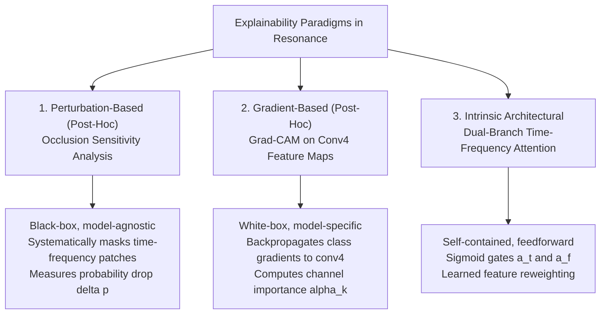
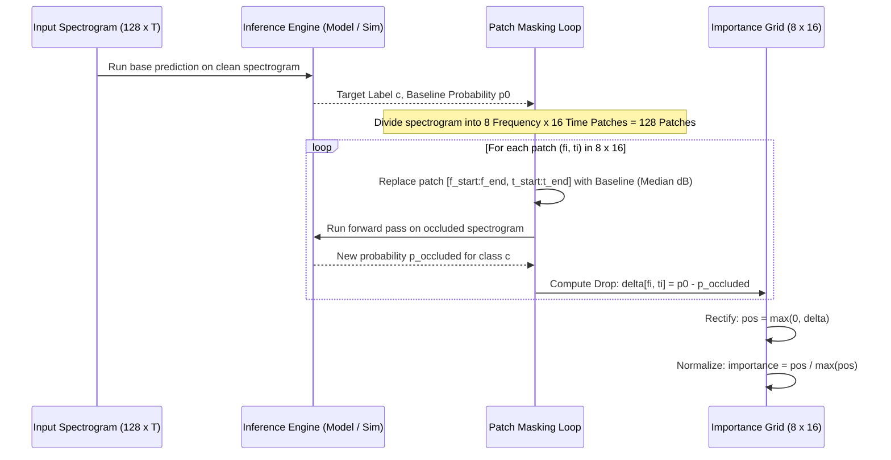
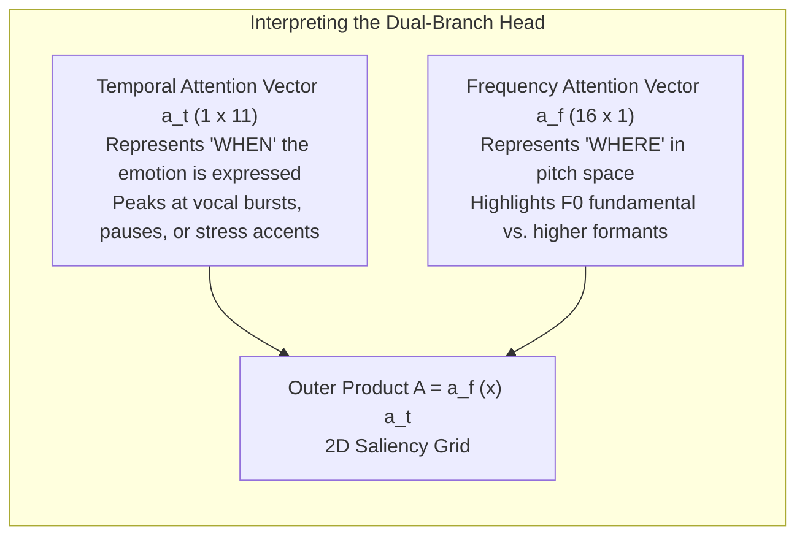

# 06. Explainable AI (XAI) for Speech Emotion Recognition

> **Core Emphasis Guide**: This document provides an exhaustive technical and theoretical guide to Explainable Artificial Intelligence (XAI) within the Resonance platform, covering the occlusion sensitivity algorithm in `backend/app/explain.py`, Grad-CAM derivations, intrinsic attention maps, and rigorous validation metrics (Adebayo sanity checks, deletion/insertion curves).

---

## 6.1 Why Explainability is Critical in Audio & SER

In classical image classification, XAI methods highlight spatial pixels (e.g., eyes of a dog, edges of a tumor). In **Speech Emotion Recognition**, explainability operates over the joint **Time-Frequency domain**:
1. **Clinical & Psychological Diagnostics**: In tele-mental health assessments (depression, anxiety), clinicians cannot trust a "black box" prediction. They need to verify that a prediction of "depression/sadness" is driven by sustained flat fundamental frequency ($F_0$) and low vocal dynamics, rather than acoustic room reverberation or a noisy microphone.
2. **Detecting Clever Hans Artifacts**: Neural networks frequently exploit spurious correlations. For example, in the RAVDESS dataset, certain actors produce louder background breathing clicks before articulating "angry" utterances. An XAI heatmap reveals whether the network is classifying anger based on high-frequency formant energy or spurious pre-speech onset clicks.
3. **Validating Linguistic Invariance**: An ideal SER system should focus on prosodic intonation rather than specific phoneme pronunciations. XAI allows researchers to inspect whether feature importance is distributed across voiced harmonic segments rather than linguistic stop consonants.

---

## 6.2 The Three Paradigms of Audio Explainability

Resonance contrasts three distinct explainability paradigms:



---

## 6.3 Deep Dive: Occlusion Sensitivity Analysis in Resonance

Implemented in `backend/app/explain.py` as `occlusion_map()`.

### 6.3.1 Algorithm Walkthrough
Occlusion sensitivity is an intuitive, model-agnostic perturbation method. It answers: *"If I hide this specific time-frequency region from the model, how much does its confidence in the predicted class drop?"*



### 6.3.2 Line-by-Line Code Dissection (`backend/app/explain.py`)

```python
FREQ_PATCHES = 8   # 8 frequency bands along the Mel axis (128 / 8 = 16 mel bins per patch)
TIME_PATCHES = 16  # 16 temporal segments along the time axis (T / 16 frames per patch)
MAX_DISPLAY_COLS = 160
```

1. **Base Prediction**:
   ```python
   base = simulate_from_logmel(lm, content_key, model_id, cfg)
   label = base["predicted_label"]
   p0 = base["probabilities"][label]
   ```
   The unperturbed spectrogram is evaluated to obtain the baseline top-1 class $c$ and its probability $p_0$.

2. **Patch Edge Definition**:
   ```python
   n_mels, T = lm.shape
   f_edges = np.linspace(0, n_mels, FREQ_PATCHES + 1, dtype=int)
   t_edges = np.linspace(0, T, TIME_PATCHES + 1, dtype=int)
   baseline = float(np.median(lm))
   ```
   * Frequency edges divide the 128 Mel bins into 8 contiguous frequency bands of width 16 bins.
   * Time edges divide the $T$ frames into 16 contiguous time windows.
   * Total number of forward passes: $8 \times 16 = 128$ evaluations.

3. **Baseline Selection (Crucial Theory)**:
   * Notice line 34: `baseline = float(np.median(lm))`
   * **Why median Log-Mel dB?** In audio, if you set masked patches to `0.0`, in a decibel scale `0 dB` represents **maximum possible energy** ($10 \log_{10}(1.0)$)! That would inject an intense high-energy blast into the network.
   * If you set it to `-80 dB` (silence), the sudden discontinuity creates high-frequency spectral leakage artifacts.
   * Replacing with the **median Log-Mel energy** of the utterance removes the local spectral peak without introducing severe out-of-distribution edge steps.

4. **Perturbation & Saliency Calculation**:
   ```python
   delta = np.zeros((FREQ_PATCHES, TIME_PATCHES))
   for fi in range(FREQ_PATCHES):
       for ti in range(TIME_PATCHES):
           occluded = lm.copy()
           occluded[f_edges[fi]:f_edges[fi + 1], t_edges[ti]:t_edges[ti + 1]] = baseline
           p = simulate_from_logmel(occluded, content_key, model_id, cfg)["probabilities"][label]
           delta[fi, ti] = p0 - p  # Probability points lost
   ```
   * If $\Delta[f_i, t_i] > 0$: Masking this patch **decreased** confidence in the target class. This region is **salient / supportive** of the prediction.
   * If $\Delta[f_i, t_i] < 0$: Masking this patch **increased** confidence in the target class (i.e., this patch was suppressing the emotion or confusing the classifier with evidence for an opposing emotion).

5. **Rectification and Normalization**:
   ```python
   pos = np.clip(delta, 0, None)
   importance = pos / pos.max() if pos.max() > 0 else pos
   ```
   Negative values are clipped to zero (ReLU rectification). The resulting array is normalized into the unit range $[0.0, 1.0]$ for visual rendering.

---

## 6.4 Grad-CAM for Spectral CNNs: Mathematical Formulation

While `explain.py` uses occlusion, the architecture specification in `finalprojectdetails.md` and `Architecture.tsx` outlines **Gradient-weighted Class Activation Mapping (Grad-CAM)** for `CNNTimeFrequencyAttention`.

### 6.4.1 Mathematical Derivation
Let $A^k \in \mathbb{R}^{U \times V}$ be the 2D feature map produced by the $k$-th channel of the final convolutional layer (`conv4`), where $U=16, V=11$, and $k \in \{1, \dots, 256\}$.
Let $y^c$ be the unnormalized logit score for target emotion class $c$.

#### Step 1: Channel Importance Weights ($\alpha_k^c$)
We compute the gradient of the class score $y^c$ with respect to the activations $A_{ij}^k$:

$$\alpha_k^c = \frac{1}{U \times V} \sum_{i=1}^{U} \sum_{j=1}^{V} \frac{\partial y^c}{\partial A_{ij}^k}$$

This global average pooling over gradients captures the importance of the $k$-th feature map channel in predicting class $c$.

#### Step 2: Weighted Combination & Rectification
We compute a weighted sum of the 256 feature maps using the weights $\alpha_k^c$, and apply a ReLU:

$$L_{\text{Grad-CAM}}^c = \text{ReLU}\left( \sum_{k=1}^{256} \alpha_k^c A^k \right)$$

* **Why ReLU?** We only care about features that have a **positive influence** on the target class score. Features that decrease $y^c$ belong to other emotion categories.

#### Step 3: Bilinear Interpolation to Input Spectrogram
$L_{\text{Grad-CAM}}^c$ has dimensions $(16 \times 11)$. To overlay it on the input Mel spectrogram $(128 \times 94)$, we apply 2D bilinear upsampling:

$$M^c(f, t) = \text{BilinearUpsample}\left( L_{\text{Grad-CAM}}^c \right) \in \mathbb{R}^{128 \times 94}$$

$$M_{\text{norm}}^c(f, t) = \frac{M^c(f, t) - \min(M^c)}{\max(M^c) - \min(M^c) + 10^{-8}}$$

---

## 6.5 Intrinsic Explainability: Dual-Branch Attention Maps

Unlike Grad-CAM (which requires backpropagation), Model A's `TimeFrequencyAttention` provides an **intrinsic, feedforward attention map** at zero additional computation cost during inference:

$$\text{attn\_map}(f, t) = a_f(f) \otimes a_t(t) \in \mathbb{R}^{16 \times 11}$$



### Comparing Grad-CAM vs. Intrinsic Attention:
* **Grad-CAM**: Class-specific ($L^c$ changes depending on which emotion logit $y^c$ you backpropagate from). Answers: *"What makes this utterance angry instead of sad?"*
* **Intrinsic Attention**: Class-agnostic (fixed feature weighting applied to all classes). Answers: *"Which acoustic regions does the encoder consider informative in general?"*

---

## 6.6 Rigorous Validation & Sanity Checks for XAI

A major criticism of deep learning explainability in academic presentations is that **saliency maps often look visually pleasing even when they are completely unfaithful to the model**.

Here is how you defend and evaluate XAI in Resonance:

### 1. The Adebayo Model Parameter Randomisation Test (Adebayo et al., NeurIPS 2018)
* **The Vulnerability**: Many saliency methods (like Guided Backprop) act merely as edge detectors or input gradient reconstructions, completely independent of the trained model weights.
* **The Sanity Check**:
  1. Compute the saliency map $M_{\text{trained}}$ using the trained model weights.
  2. Compute the saliency map $M_{\text{random}}$ on the exact same audio using **randomly initialized weights** (`cnn_tfa_model.pt`).
  3. Compute the Structural Similarity Index (SSIM) or Pearson correlation between $M_{\text{trained}}$ and $M_{\text{random}}$.
  * **Expected Outcome**: If the XAI method is genuinely faithful, the correlation must drop to near zero ($\rho < 0.15$). If $M_{\text{trained}} \approx M_{\text{random}}$, the method is invalid and has failed the sanity check.

### 2. Faithfulness Metric: Deletion Curve (Area Under Curve - AUC)
To objectively quantify whether highlighted patches actually drive the prediction:
1. Sort all time-frequency patches by importance score in descending order.
2. Progressively mask the top $k\%$ most salient patches ($k \in [0\%, 10\%, 20\%, \dots, 90\%]$) with baseline median energy.
3. At each step, record the classifier probability for the predicted class.
4. Plot the **Deletion Curve**: probability vs. percentage of features removed.
* **Criterion**: A sharp, steep drop in probability (low Area Under Deletion Curve) proves that the explanation correctly identified the critical acoustic features.

```
Probability p(class)
 1.0 |-----\
 0.8 |      \
 0.6 |       \  <- Faithful XAI (Rapid collapse)
 0.4 |        \
 0.2 |         \----------------
 0.0 +---------------------------> % Features Removed
     0%  20%  40%  60%  80% 100%
```

### 3. Insertion Curve
* Start with a blank (median) spectrogram.
* Progressively insert the top $k\%$ most salient patches from the original audio.
* **Criterion**: Rapid rise in probability indicates high explanation fidelity.

---

## 6.7 Frontend Visualization: Canvas Rendering

In `frontend/src/components/SpectrogramView.tsx`:
* The Mel-spectrogram is drawn on an HTML5 `<canvas>` using a custom colormap `ramp(t)`:
  * Low energy ($-80\text{ dB}$): Deep Navy `rgb(11, 27, 51)`
  * Mid energy ($-40\text{ dB}$): Steel Teal `rgb(26, 158, 168)`
  * Peak energy ($0\text{ dB}$): Soft White `rgb(232, 246, 240)`
* The occlusion heatmap is rendered as a semi-transparent amber grid:
  `rgba(234, 138, 22, 0.15 + 0.6 * importance)`
* A subtle white grid overlay (`lineWidth = 0.5`) marks the boundaries of the $8 \times 16$ time-frequency patches, enabling precise temporal and frequency localization for the user.
