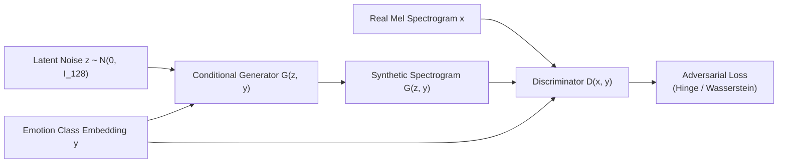
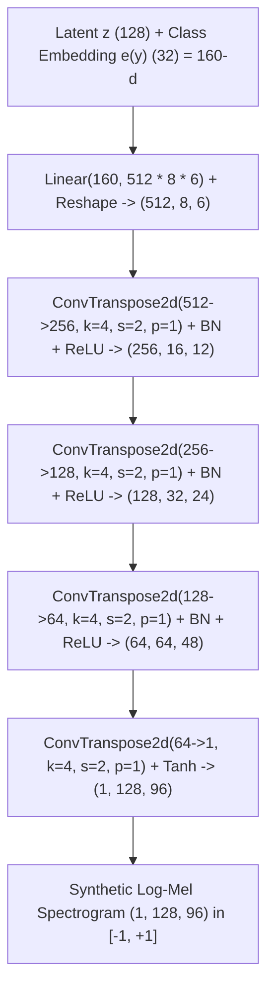
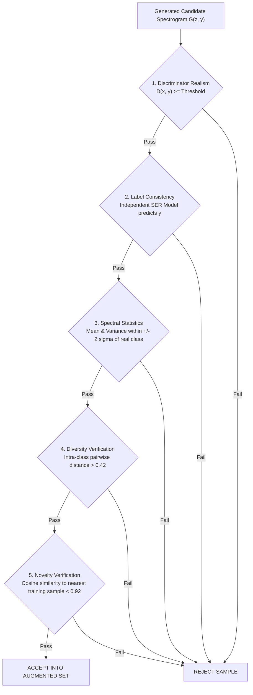

# 07. Generative Adversarial Network (GAN) Augmentation

> **Core Emphasis Guide**: This document details the generative deep learning framework in Resonance, covering the mathematical theory of Generative Adversarial Networks (GANs), conditional spectrogram generation (cDCGAN), the 6-stage augmentation pipeline, 5 automated quality-check gates, and evaluation metrics (FAD, TSTR/TRTR, diversity).

---

## 7.1 The Class Imbalance Problem in Speech Emotion Recognition

In benchmark speech emotion corpora (e.g., RAVDESS, CREMA-D, IEMOCAP), emotion classes suffer from severe acoustic and sample imbalance:
1. **Minority Emotions (Fear & Disgust)**: Human actors and unscripted speakers produce far fewer convincing examples of visceral emotions like *disgust* or *terror/fear* compared to *anger* or *neutral*.
2. **Acoustic Variance Asymmetry**: High-arousal emotions (anger) exhibit high acoustic energy and distinct pitch jumps, making them easy for classifiers to identify. Low-arousal, negative-valence emotions (sadness, disgust) frequently collapse into neutral acoustic profiles, causing low recall and high false-negative rates.
3. **Limitations of Conventional Augmentation**:
   * *Pitch shifting* alters speaker vocal-tract identity rather than emotional prosody.
   * *Time stretching* distorts speech cadence uniformly without modeling emotion-specific syllable duration.
   * *SpecAugment* (time/frequency masking) acts as regularization but cannot synthesize *new* emotional inflection patterns.

**The Solution**: A **Conditional Deep Convolutional GAN (cDCGAN)** trained exclusively on the training split to synthesize photorealistic Log-Mel spectrograms conditioned on minority emotion labels.

---

## 7.2 Mathematical Foundations of Generative Adversarial Networks

A GAN consists of two neural networks engaged in a zero-sum game:
* **Generator ($G$)**: Maps random noise $z \sim p_z(z)$ and class label $y$ to synthetic data $\tilde{x} = G(z, y)$.
* **Discriminator ($D$)**: Evaluates whether an input $x$ is a real spectrogram from the dataset or a synthetic candidate produced by $G$.



### 7.2.1 The Minimax Objective
The classical formulation (Goodfellow et al., 2014) defines the value function $V(D, G)$:

$$\min_G \max_D V(D, G) = \mathbb{E}_{x \sim p_{\text{data}}(x)} \big[ \log D(x \mid y) \big] + \mathbb{E}_{z \sim p_z(z)} \big[ \log \big( 1 - D(G(z \mid y) \mid y) \big) \big]$$

### 7.2.2 The Hinge Adversarial Loss (Resonance Specification)
Standard minimax loss suffers from vanishing gradients when the discriminator becomes too strong. Resonance specifies the **Hinge Loss with Spectral Normalization** (Miyato et al., 2018), which stabilizes training and prevents mode collapse:

$$\mathcal{L}_D = -\mathbb{E}_{(x, y) \sim p_{\text{data}}} \big[ \min(0, -1 + D(x, y)) \big] - \mathbb{E}_{z \sim p_z, y \sim p_y} \big[ \min(0, -1 - D(G(z, y), y)) \big]$$

$$\mathcal{L}_G = -\mathbb{E}_{z \sim p_z, y \sim p_y} \big[ D(G(z, y), y) \big]$$

* **Interpretation**: The discriminator is penalized only when real samples score below $+1$ or synthetic samples score above $-1$, establishing a safe margin.

---

## 7.3 Detailed Architecture of the Conditional Spectrogram GAN

Target synthetic tensor size: Log-Mel Spectrogram of $(1 \times 128 \times 96)$ (128 Mel frequency bins $\times$ 96 temporal frames $\approx 3.0$ seconds at hop length 512).

### 7.3.1 Conditional Generator Architecture ($G$)

Input: Latent vector $z \in \mathbb{R}^{128}$ sampled from $\mathcal{N}(0, I)$, concatenated with a 32-dimensional learnable emotion class embedding $e(y) \in \mathbb{R}^{32}$ for the 6 emotion classes $\implies \text{Input vector} \in \mathbb{R}^{160}$.



#### Tensor Transformations in $G$:
1. **Projection**: $160 \to 512 \times 8 \times 6 = 24,576 \implies$ reshaped to $(B, 512, 8, 6)$.
2. **Block 1**: Transposed Conv $4 \times 4$, stride 2, padding 1:
   $$H_{\text{out}} = (8 - 1) \times 2 - 2(1) + 4 = 16, \quad W_{\text{out}} = (6 - 1) \times 2 - 2(1) + 4 = 12 \implies (B, 256, 16, 12)$$
3. **Block 2**: Transposed Conv $4 \times 4$, stride 2, padding 1: $\implies (B, 128, 32, 24)$
4. **Block 3**: Transposed Conv $4 \times 4$, stride 2, padding 1: $\implies (B, 64, 64, 48)$
5. **Block 4 (Output)**: Transposed Conv $4 \times 4$, stride 2, padding 1 $\implies (B, 1, 128, 96)$
   * Activation: $\tanh$, scaling output values to $[-1.0, +1.0]$.
* **Total Parameters in $G$**: Approximately $\mathbf{3.6\text{ Million}}$.

---

### 7.3.2 Projection Discriminator Architecture ($D$)

Following Miyato & Koyama (ICLR 2018), conditioning on class labels is achieved via an **inner product projection** rather than naive channel concatenation:

$$D(x, y) = \psi(h(x)) + \langle e(y), h(x) \rangle$$
where $h(x) \in \mathbb{R}^{512}$ is the feature vector after global pooling, $\psi$ is a linear projection to scalar, and $e(y)$ is a class embedding.

* Every convolutional layer applies **Spectral Normalization** (`nn.utils.spectral_norm`):
  $$\bar{W} = \frac{W}{\sigma(W)}$$
  where $\sigma(W)$ is the spectral norm (largest singular value) of weight matrix $W$. This enforces a 1-Lipschitz continuity constraint, preventing gradient explosions.

---

## 7.4 The 6-Stage Augmentation Pipeline

As visualized in `frontend/src/pages/GanAugmentation.tsx`:

```
[Step 1: Real Training Spectrograms]
  └─ Speaker-independent training split only; strict zero-test-data leakage.
        │
        ▼
[Step 2: Conditional Generator]
  └─ Latent noise z + emotion label embedding -> Candidate synthetic Mel spectrogram.
        │
        ▼
[Step 3: Synthetic Candidates Pool]
  └─ Batch generation conditioned on target minority classes (Fear, Disgust).
        │
        ▼
[Step 4: Automated 5-Stage Quality-Check Gate]
  └─ Rigorous acceptance filtering before admitting synthetic samples into dataset.
        │
        ▼
[Step 5: Augmented Training Dataset]
  └─ Real training samples + Accepted synthetic samples at chosen ratio (e.g., 0.5:1).
        │
        ▼
[Step 6: Classifier Evaluation]
  └─ Train Model A (CNN-TFA) and Model B (BiLSTM) on augmented set; evaluate Macro-F1 on test speakers.
```

---

## 7.5 The 5 Automated Quality-Check Gates

A critical innovation in Resonance's GAN specification is that **not all generated samples are accepted**. Blindly adding low-quality or mode-collapsed synthetic samples degrades classifier performance. Each candidate must pass 5 sequential tests:



### Mathematical Definitions of the 5 Gates:

1. **Gate 1: Discriminator Realism Gate**:
   * Evaluates discriminator score $D(x, y) \ge \tau_{\text{realism}}$.
   * Discards poorly formed candidates with obvious checkerboard artifacts or unnatural noise bands.

2. **Gate 2: Label Consistency Verification**:
   * A separate pre-trained classifier $C_{\text{eval}}$ (e.g., baseline Plain CNN trained only on real data) evaluates the candidate:
     $$\arg\max C_{\text{eval}}(G(z, y)) \stackrel{?}{=} y$$
   * If the candidate was conditioned on "fear" but the independent classifier identifies it as "neutral", it is rejected.

3. **Gate 3: Spectral Distribution Alignment**:
   * Computes per-mel-band mean $\mu_m^{\text{cand}}$ and variance $\sigma_m^{\text{cand}}$.
   * Asserts that candidate statistics lie within a 2-standard-deviation confidence band of genuine real recordings for that emotion class:
     $$|\mu_m^{\text{cand}} - \mu_m^{\text{real}}| \le 2 \cdot \sigma_m^{\text{real}} \quad \forall m \in [1, 128]$$

4. **Gate 4: Diversity Verification (Anti-Mode Collapse)**:
   * Mode collapse occurs when $G$ learns to output a single identical "perfect" spectrogram regardless of $z$.
   * We compute average pairwise Euclidean distance across a batch of $B$ candidates for class $y$:
     $$\text{Div}(y) = \frac{2}{B(B-1)} \sum_{i < j} \| G(z_i, y) - G(z_j, y) \|_2 > 0.42$$

5. **Gate 5: Novelty Check (Anti-Memorization Gate)**:
   * Asserts that $G$ has learned a true generative distribution rather than simply memorizing and regurgitating training samples.
   * Computes cosine similarity against all $N$ real training samples $\{x_j^{\text{train}}\}$:
     $$\max_{j \in [1, N]} \frac{\langle \text{vec}(G(z, y)), \text{vec}(x_j^{\text{train}}) \rangle}{\|G(z,y)\|_2 \|x_j^{\text{train}}\|_2} < 0.92$$
   * Any sample with cosine similarity $\ge 0.92$ is flagged as a near-duplicate and pruned.

---

## 7.6 Rigorous Evaluation Metrics for Generative Speech

In your viva presentation, you should explain the exact academic protocol for evaluating GAN quality:

### 1. Fréchet Audio Distance (FAD)
Analogous to Fréchet Inception Distance (FID) in computer vision. We pass real spectrograms and synthetic spectrograms through a pretrained audio embedding model (e.g., VGGish or the penultimate layer of CNN-TFA) to extract feature vectors:
* Real distribution: $\mathcal{N}(\mu_r, \Sigma_r)$
* Synthetic distribution: $\mathcal{N}(\mu_g, \Sigma_g)$

$$\text{FAD} = \| \mu_r - \mu_g \|_2^2 + \text{Tr}\big( \Sigma_r + \Sigma_g - 2(\Sigma_r \Sigma_g)^{1/2} \big)$$
* **Interpretation**: Lower FAD indicates higher acoustic realism and closer distributional match.

### 2. Train on Synthetic, Test on Real (TSTR)
* Train Model A exclusively on synthetic data $D_{\text{synth}}$ generated by $G$.
* Evaluate Model A on the genuine, held-out test split of real speakers $D_{\text{real}}^{\text{test}}$.
* **Significance**: If the classifier achieves high accuracy on real speakers after being trained *only* on synthetic data, it proves that the GAN has captured the true underlying acoustic features of emotion.

### 3. Ablation Study: Augmentation Ratio
Evaluate the downstream Macro-F1 across ratios:
$$\text{Ratio} \in \{ 0.0\text{ (Real only)}, 0.25, 0.5, 0.75, 1.0, 1.5, 2.0 \}$$
* Expected curve: Performance peaks around $0.5 : 1$ or $1.0 : 1$ and plateaus or drops if synthetic ratio is too high (due to synthetic bias drift).

---

## 7.7 Inverting Spectrograms to Audio: Griffin-Lim

Although CNN-TFA classifies spectrograms directly without needing audio inversion, a live demo is much more impressive if the professor can **hear** the generated spectrogram.

Because a Mel-spectrogram discards phase information:
1. Invert Mel filterbank to linear STFT magnitude:
   $$S \approx M^+ \cdot S_{\text{mel}}$$
2. Apply the **Griffin-Lim Algorithm** (`librosa.feature.inverse.mel_to_audio`):
   * Iteratively estimates the missing phase by alternating between STFT and ISTFT projections until convergence (typically 32–64 iterations).
   * Result: Listen-able 16 kHz WAV audio demonstrating the synthetic emotional prosody!
