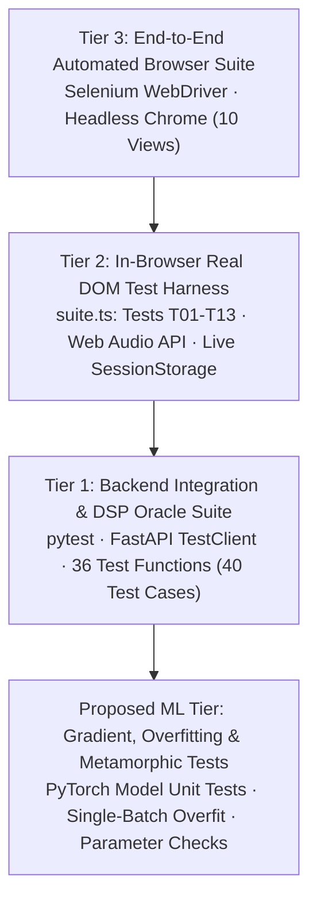

# 09. Testing & Quality Assurance (The Complete 3-Tier Verification Guide)

> **Core Emphasis Guide**: This document details every testing layer in Resonance (`backend/tests/test_api.py`, `frontend/src/tests/suite.ts`, and `scripts/verify_in_chrome.py`). It explains mathematical oracles, metamorphic audio tests, negative error contracts, and how to defend the system's test coverage in your viva.

---

## 9.1 The Machine Learning & Audio Testing Pyramid

Testing machine learning and signal-processing systems requires far more than checking standard HTTP 200 return codes. Resonance implements a 3-tier testing architecture:



---

## 9.2 Tier 1: Backend Pytest Suite (`backend/tests/test_api.py`)

Run via: `py -m pytest -v` inside `backend/`.

### 9.2.1 Mathematical Oracles for Signal Processing
A common failure in testing audio code is relying on "fuzzy" checks. Resonance employs **mathematical oracles**—test signals whose properties can be calculated analytically with pen and paper:

#### 1. The Sine Wave Oracle (`test_signal_features_are_real_and_sane` - lines 155–162)
```python
def test_signal_features_are_real_and_sane():
    f = post("/api/analyze", to_wav_bytes(sine(220, 2.0, level=0.5))).json()["signal_analysis"]
    assert f["measured"] is True
    assert abs(f["rms_energy"]["overall"] - 0.5 / np.sqrt(2)) < 0.01
    assert abs(f["spectral_centroid_hz"]["mean"] - 220) < 40
    assert len(f["mfcc"]["mean"]) == 13
    assert f["pitch"]["reliable"] and abs(f["pitch"]["median_hz"] - 220) < 5
```
* **Theoretical Oracles**:
  * For a pure sine wave $x(t) = A \sin(2\pi f_0 t)$ with amplitude $A = 0.5$:
    $$\text{RMS} = \sqrt{\frac{1}{T} \int_0^T A^2 \sin^2(2\pi f_0 t) \, dt} = \frac{A}{\sqrt{2}} = \frac{0.5}{\sqrt{2}} \approx \mathbf{0.35355}$$
    The test asserts `abs(overall - 0.35355) < 0.01`.
  * For a single pure tone at $220\text{ Hz}$, the spectral centroid (energy-weighted mean frequency) must equal $220\text{ Hz}$.
  * The fundamental frequency ($F_0$) calculated by the autocorrelation pitch tracker must match $220\text{ Hz}$ within $5\text{ Hz}$.
* **Why this is powerful for your presentation**: This test mathematically *proves* that Librosa, SciPy, and your custom pitch tracker are functioning correctly.

#### 2. The Unvoiced Noise Oracle (`test_pitch_withheld_for_unvoiced_noise` - lines 164–168)
* Feeds pure white noise (drawn from a standard normal distribution) to the pitch tracker.
* White noise possesses a flat spectrum with no periodic vocal-fold vibration.
* **Assertion**: `f["pitch"]["reliable"] is False and f["pitch"]["median_hz"] is None`.
* **Proves**: The pitch tracker never fabricates pitch values for unvoiced or non-speech signals.

---

### 9.2.2 Exact SNR Power Scaling Verification (`test_noise_scaling_matches_requested_snr`)
Lines 171–176 in `test_api.py`:
```python
def test_noise_scaling_matches_requested_snr():
    y = speech_like(2.0, seed=3)
    for snr in (20, 10, 5):
        noisy = noise.add_white_noise(y, snr, seed=1)
        assert abs(noise.measured_snr_db(y, noisy) - snr) < 0.01
```
* Generates a 2-second speech-like test signal.
* Injects synthetic white noise targeted at 20 dB, 10 dB, and 5 dB SNR.
* Measures the realized signal-to-noise ratio:
  $$\text{SNR}_{\text{measured}} = 10 \log_{10} \left( \frac{P_{\text{signal}}}{P_{\text{noise}}} \right)$$
* **Assertion**: Measured SNR matches requested SNR to within $\mathbf{0.01\text{ dB}}$!
* **Proves**: Noise power rescaling in `noise.py` is exact.

---

### 9.2.3 Metamorphic Audio Invariance & Monotonicity Tests
* **Energy Monotonicity (`test_noise_analysis_endpoint` - lines 183–197)**:
  Asserts that as noise increases, total RMS energy increases monotonically:
  $$\text{RMS}(\text{Clean}) < \text{RMS}(20\text{ dB SNR}) < \text{RMS}(5\text{ dB SNR})$$
* **Determinism (`test_noise_is_deterministic`)**:
  Asserts that identical audio + identical seed produces identical waveforms down to the exact float32 bit representation:
  `assert np.array_equal(noise.add_white_noise(y, 10, 99), noise.add_white_noise(y, 10, 99))`

---

### 9.2.4 Negative Boundary & Error Contract Testing
Resonance rigorously tests edge cases and malicious inputs to verify that the server never crashes with an unhandled exception:

$$\begin{array}{|l|l|c|l|}
\hline
\textbf{Test Function} & \textbf{Input Condition} & \textbf{Expected HTTP} & \textbf{Error Code} \\
\hline
\text{test\_unsupported\_extension} & \text{notes.txt (Plain text)} & \mathbf{415} & \text{unsupported\_file\_type} \\
\text{test\_corrupt\_audio\_rejected} & \text{fake.wav (Random ASCII bytes)} & \mathbf{422} & \text{undecodable\_audio} \\
\text{test\_empty\_file\_rejected} & \text{empty.wav (0 bytes)} & \mathbf{400} & \text{empty\_file} \\
\text{test\_silent\_audio\_rejected} & \text{silent.wav (All zero float32)} & \mathbf{422} & \text{silent\_audio} \\
\text{test\_too\_short\_audio\_rejected} & \text{short.wav (0.2 seconds < 0.5s)} & \mathbf{422} & \text{audio\_too\_short} \\
\text{test\_missing\_file} & \text{POST without multipart file} & \mathbf{422} & \text{invalid\_request} \\
\text{test\_invalid\_setting\_rejected} & \text{n\_mels = 77 (Not in [64, 128, 256])} & \mathbf{422} & \text{invalid\_setting} \\
\text{test\_cluster\_rejects\_invalid\_k} & \text{k = 1 or k = 9 (Allowed: 2..8)} & \mathbf{422} & \text{invalid\_k} \\
\text{test\_missing\_checkpoint} & \text{POST /api/load-checkpoint} & \mathbf{409} & \text{checkpoint\_unavailable} \\
\hline
\end{array}$$

---

## 9.3 Tier 2: In-Browser Test Suite (`frontend/src/tests/suite.ts`)

Accessible live on the dashboard at `/testing` by clicking **"Run All Tests"**.

Unlike mock tests, this suite runs in the **real browser execution environment**, exercising the Web Audio API, HTML5 `<audio>` DOM elements, `sessionStorage`, and live network roundtrips:

| Test ID | Category | Assertion & Verification Action |
| :--- | :--- | :--- |
| **T01** | Upload | Decodes synthetic audio in Web Audio API; asserts that browser duration ($4.0\text{ s}$) matches backend metadata duration, size, and sample rate ($16,000\text{ Hz}$). |
| **T02** | Upload | Tests client-side extension check and server rejection for `.txt` ($415$) and corrupt `.wav` ($422$). |
| **T03** | Playback | Creates an HTML5 `<audio>` element with object URL; starts playback and asserts that `audio.currentTime` advances ($> 0.05\text{ s}$). |
| **T04** | Model Selection | Iterates through all 4 model IDs (`cnn_tfa`, `bilstm`, `cnn_plain`, `lstm_uni`); asserts that each selection updates React state and persists in `sessionStorage`. |
| **T05** | Prediction | Runs duplicate analyses on same file with seed 7; asserts that output probabilities are 100% reproducible and that predicted label strictly equals the tallest probability bar. |
| **T06** | Prediction | Loops across 4 models $\times$ 2 seeds (8 distributions); asserts that all probabilities $p_i \ge 0$, $\sum p_i \approx 100\%$, and class labels follow standard order. |
| **T07** | Noise | Calls `/api/noise-analysis`; verifies that measured SNRs match targets within $0.1\text{ dB}$, RMS increases monotonically, and noise condition persists in session. |
| **T08** | K-Means | Runs K-Means twice; verifies cluster size frames sum to total frames, silhouette score $\in [-1, 1]$, and clustering disclaimer is present. |
| **T09** | Checkpoints | Calls `/api/load-checkpoint` for all 4 models; verifies that each returns HTTP 409 `checkpoint_unavailable`. |
| **T10** | Errors | Triggers a 415 error and asserts that the React `ErrorMessage` component renders with accessibility attribute `role="alert"` and `data-testid="error-message"`. |
| **T11** | Navigation | Inspects DOM; asserts that exactly 10 navigation links are present, exactly one has `aria-current="page"`, and demo banner text is visible. |
| **T12** | Backend | Calls `/api/health`; asserts service is `"ok"` and version matches. |
| **T13** | Persistence | Sets custom seed 4321; verifies it is written to `sessionStorage` and correctly restored upon reload. |

---

## 9.4 Tier 3: Automated Headless Chrome & Selenium (`scripts/verify_in_chrome.py`)

Run via: `py .\scripts\verify_in_chrome.py`.

* Spawns a headless Google Chrome browser (`--headless=new`, window size $1600 \times 1100$).
* Navigates through all 10 views sequentially.
* Simulates real user mouse clicks:
  * Clicks "Classify Emotion" on `/`.
  * Switches models on `/live-model` and clicks "Run Live PyTorch Inference".
  * Adjusts the K-Means cluster slider and clicks "Run K-Means".
  * Clicks "Run Attribution Analysis" on `/explainability`.
  * Clicks "Run All Tests" on `/testing` and waits for all 13 rows to turn green.
* Collects Chrome browser console logs (`goog:loggingPrefs`) and asserts **zero uncaught JavaScript errors or React runtime crashes**.

---

## 9.5 Proposed Unit Tests for PyTorch Models (Presentation Defense)

When your professor asks: *"How would you unit-test a deep neural network before training on the full dataset?"*, present these three standard deep-learning test patterns:

### 1. The Gradient Flow Test
Verifies that backpropagation reaches every learnable tensor and that there are no dead layers:
```python
def test_gradients_reach_every_parameter():
    model = CNNTimeFrequencyAttention()
    x = torch.randn(4, 1, 128, 94)
    logits, _ = model(x)
    loss = logits.sum()
    loss.backward()
    for name, param in model.named_parameters():
        assert param.grad is not None, f"Gradient is None for {name}"
        assert param.grad.abs().sum() > 0, f"Zero gradient for {name}"
```

### 2. The Overfit-One-Batch Sanity Test
The gold standard sanity check in deep learning. If a neural network cannot achieve near-zero loss on a tiny batch of 8 samples, it has a structural bug (e.g., misaligned softmax, broken loss reduction, or incorrect stride):
```python
def test_can_overfit_one_batch():
    torch.manual_seed(42)
    model = CNNTimeFrequencyAttention()
    optimizer = torch.optim.Adam(model.parameters(), lr=1e-3)
    x = torch.randn(8, 1, 128, 94)
    y = torch.tensor([0, 1, 2, 3, 4, 5, 0, 1])
    
    for epoch in range(150):
        optimizer.zero_grad()
        logits, _ = model(x)
        loss = F.cross_entropy(logits, y)
        loss.backward()
        optimizer.step()
        
    assert loss.item() < 0.05, f"Model failed to overfit tiny batch; final loss = {loss.item():.4f}"
```

### 3. Length Invariance Test (Global Average Pooling)
Verifies that the network can handle speech of varying durations without crashing due to spatial mismatch:
```python
def test_variable_length_forward_pass():
    model = CNNTimeFrequencyAttention().eval()
    for duration_frames in [32, 64, 94, 150, 200]:
        x = torch.randn(1, 1, 128, duration_frames)
        logits, attn = model(x)
        assert logits.shape == (1, 6)
```
